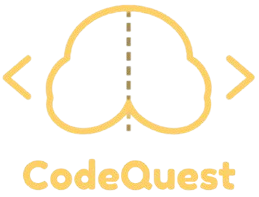

# CodeQuest | Quiz Online
 
<p align="center">
  
</p>
O CodeQuest é um quiz online de programação no estilo tech trivia. O jogador digita o nome, responde 10 perguntas de múltipla escolha (4 alternativas, só uma correta) sobre JavaScript, HTML, CSS, SQL, estruturas de dados e história da computação, vê o resultado na hora e entra num ranking com as 10 melhores pontuações.
 
As perguntas, as alternativas e as partidas ficam num banco PostgreSQL no Supabase. O front-end não fala com o banco diretamente: ele chama uma API em Node.js, que consulta o Supabase e calcula a pontuação oficial no servidor.
 
## Funcionalidades
 
- Tela inicial com o nome do jogador e acesso ao ranking.
- Quiz com as perguntas carregadas do banco, contador (`1/10`), barra de progresso e destaque da alternativa certa e da errada após cada resposta.
- Tela de resultado com a pontuação e uma mensagem conforme o desempenho (9 ou mais, 7 ou mais, 5 ou mais, abaixo de 5).
- Ranking com o top 10. Em caso de empate, fica na frente quem jogou primeiro.
- A pontuação salva no ranking é recalculada pelo servidor a partir das alternativas marcadas, então não dá para "forjar" pontos pelo navegador.
## Tecnologias
 
| Camada | Tecnologias |
| --- | --- |
| Front-end | HTML, CSS e JavaScript puro (sem frameworks), fontes Fredoka e Poppins do Google Fonts |
| Back-end | Node.js usando só o módulo nativo `http` (sem Express), com `@supabase/supabase-js` e `dotenv` |
| Banco de dados | PostgreSQL hospedado no Supabase, com RLS (Row Level Security) |
| Deploy | API no Render |
 
 
## Banco de dados
 
O banco tem quatro tabelas:
 
| Tabela | O que guarda |
| --- | --- |
| `pergunta` | Enunciado e pontuação de cada pergunta (cada uma vale 1 ponto) |
| `resposta` | As 4 alternativas de cada pergunta, com `correta` = `TRUE` em apenas uma |
| `partida` | Nome do jogador e total de pontos da partida |
| `ranking` | Os pontos de cada partida em cada pergunta (valor da pergunta se acertou, 0 se errou). Uma partida não pode repetir a mesma pergunta |
 
### Arquivos SQL
 
Os scripts ficam em `data/` e devem ser executados nesta ordem, num banco vazio:
 
1. **`codequest_bd.sql`** (DDL): cria as tabelas `partida`, `pergunta`, `resposta` e `ranking`, com chaves primárias, chaves estrangeiras e a restrição única `(cod_partida, cod_pergunta)` no ranking.
2. **`codequest_dml.sql`** (DML): insere as 10 perguntas, as 40 alternativas, 5 partidas de exemplo (com um empate de 7 pontos para testar o desempate) e as 50 linhas do ranking. No final, ajusta as sequências `SERIAL` para os próximos `INSERT`s continuarem a partir dos códigos já usados.
3. **`codequest_testes.sql`**: consultas de conferência, divididas em quatro partes:
   - Parte 1: quantidade de registros (esperado: pergunta 10, resposta 40, partida 5, ranking 50).
   - Parte 2: integridade. Cada consulta lista o que está errado, então o esperado é 0 linhas.
   - Parte 3: consultas que o site usa (perguntas com alternativas, gabarito, ranking, desempenho por partida, taxa de acerto, média).
   - Parte 4: comandos que o banco deve recusar (vêm comentados, para testar um por vez).
No Supabase, cole o conteúdo de cada arquivo no **SQL Editor** e execute na ordem acima. Com o `psql`, fica assim:
 
```bash
psql -d codequest -v ON_ERROR_STOP=1 -f data/codequest_bd.sql
psql -d codequest -v ON_ERROR_STOP=1 -f data/codequest_dml.sql
psql -d codequest -f data/codequest_testes.sql
```
 
### RLS (Row Level Security)
 
A API usa a chave pública `anon` do Supabase, então o acesso às tabelas é controlado pelas políticas de RLS. Para a aplicação funcionar, o papel `anon` precisa de:
 
- `SELECT` em `pergunta`, `resposta` e `partida`;
- `INSERT` em `partida` e `ranking`.
As políticas são configuradas no painel do Supabase e não estão nos scripts SQL deste repositório.
 
| Variável | Obrigatória | Descrição |
| --- | --- | --- |
| `SUPABASE_URL` | Sim | URL do projeto no Supabase (Project Settings > API) |
| `SUPABASE_ANON_KEY` | Sim | Chave `anon` (pública). Não use a chave `service_role`, que ignora o RLS |
| `PORT` | Não | Porta da API. Padrão: `3000` |
| `ALLOWED_ORIGIN` | Não | Origem do front-end liberada no CORS. Padrão: `*` (qualquer origem). Use o endereço do Live Server em desenvolvimento e o domínio do site em produção |
 
## Como rodar localmente
 
Pré-requisitos: Node.js instalado, um projeto no Supabase com os scripts SQL já executados e o VS Code com a extensão **Live Server**.
 
1. Clone o repositório:
   ```bash
   git clone https://github.com/Gabs4256/CodeQuest-Quiz_Online.git
   cd CodeQuest-Quiz_Online
   ```
 
2. Suba a API:
   ```bash
   cd backend
   npm install
   # crie o arquivo .env como mostrado acima
   npm start
   ```
 
   O terminal deve mostrar `Servidor rodando na porta 3000`. Para testar, abra `http://localhost:3000/api/perguntas` no navegador.
3. Abra o front-end: no VS Code, clique com o botão direito em `login.html` e escolha **Open with Live Server**. O site abre em `http://127.0.0.1:5500/login.html`.
O endereço da API usado pelo front fica em `config.js`:
 
```js
const API_BASE_URL = "http://localhost:3000";
```
 
Depois do deploy no Render, troque esse valor pela URL pública da API.
 
## Fluxo da aplicação
 
1. `login.html`: o jogador digita o nome e o formulário abre `quiz.html?nomeJogador=...`.
2. `quiz.js` guarda o nome no `localStorage`, busca `GET /api/perguntas` e mostra uma pergunta por vez.
3. Na última pergunta, envia `POST /api/partidas` e grava a pontuação devolvida pelo servidor no `localStorage`.
4. `resultado.html` mostra a pontuação e a mensagem final.
5. `ranking.html` busca `GET /api/ranking` e monta a lista.

## Equipe
 
- Gabriel Venancio
- Gustavo de Oliveira Andrade
- Isabelle Boato de Souza
- Gabriel Oliveira dos Santos
